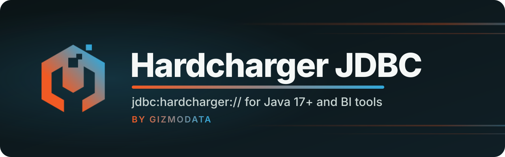

<p align="center">
  <a href="https://github.com/gizmodata/hardcharger">
    
  </a>
</p>

<p align="center">
  
  
  <a href="https://github.com/gizmodata/hardcharger"></a>
  <a href="https://github.com/gizmodata/warp-sql-jdbc"></a>
  <a href="https://github.com/gizmodata/hardcharger-jdbc/releases/latest"></a>
  <a href="LICENSE"></a>
  <a href="https://gizmodata.com"></a>
</p>

<h3 align="center">Hardcharger for Java applications, DBeaver and other JDBC tools: one jar.</h3>

---

## ☕ What is it?

The JDBC driver for [Hardcharger](https://github.com/gizmodata/hardcharger), GizmoData's DuckDB 2.0
server. Hardcharger speaks [Warp SQL](https://github.com/gizmodata/warp-sql), so this driver is a
thin layer on the [Warp SQL JDBC driver](https://github.com/gizmodata/warp-sql-jdbc): it accepts
`jdbc:hardcharger://` URLs, uses Hardcharger's port (31337) when the URL names none, and names
itself "Hardcharger JDBC Driver" to the tools that show it. Everything else, from TLS to result
streaming and partitioned reads, is the Warp SQL driver's.

**Status: 0.1.0-SNAPSHOT.** Nothing is published yet.

## 🛠️ Build

The Warp SQL JDBC driver is a submodule until it is published:

```bash
git clone --recurse-submodules https://github.com/gizmodata/hardcharger-jdbc.git
cd hardcharger-jdbc
mvn -f third_party/warp-sql-jdbc/pom.xml -DskipTests -DskipITs install   # the Warp SQL driver, into ~/.m2
mvn package            # unit tests, then the jars
mvn verify             # also the integration tests (needs a hardcharger-server; see Testing)
```

Two jars come out:

| Jar | Contents | For |
|---|---|---|
| `target/hardcharger-jdbc.jar` | this driver, the Warp SQL driver and every dependency, relocated | DBeaver and other tools, or any class path: it is the only file you need |
| `target/hardcharger-jdbc-<version>.jar` | this driver only | builds that already bring `warp-sql-jdbc` |

## 🚀 Connect

```
jdbc:hardcharger://host[:port][/catalog][?key=value&...]
```

The port defaults to 31337. TLS is on unless `useEncryption=false`, as with `jdbc:warp://`; there
is no separate scheme for plain HTTP. Options can also follow semicolons or come in the
`Properties`, and keys are case-insensitive.

```java
Properties properties = new Properties();
properties.setProperty("user", "hardcharger");
properties.setProperty("password", "change-me");
properties.setProperty("useEncryption", "false"); // plain HTTP on localhost
try (Connection connection = DriverManager.getConnection("jdbc:hardcharger://localhost", properties);
     ResultSet rows = connection.createStatement().executeQuery("SELECT 42 AS answer")) {
  rows.next();
  System.out.println(rows.getInt("answer"));
}
```

The connection properties (`tlsRootCerts`, mutual TLS, `async`, `retainResults`,
`ipcCompression`, `resultPartitions`, ...) and their defaults are the Warp SQL driver's: see its
[property table](https://github.com/gizmodata/warp-sql-jdbc#properties). This driver sets no
defaults of its own beyond the port.

What is Hardcharger's in `DatabaseMetaData`:

| Method | Answer |
|---|---|
| `getDriverName()` | `Hardcharger JDBC Driver` |
| `getDriverVersion()`, `getDriverMajorVersion()`, `getDriverMinorVersion()` | this driver's version |
| `getURL()` | the `jdbc:hardcharger:` URL you gave, with passwords and tokens shown as `***` |
| `getDatabaseProductName()`, `getDatabaseProductVersion()` | the server's own answer: `Hardcharger`, and its version |

`connection.unwrap(com.gizmodata.warpsql.jdbc.WarpConnection.class)` reaches the Warp SQL
connection (for `getSessionId()`, for example). `Statement.getConnection()` returns that Warp SQL
connection too, not the Hardcharger one. `jdbc:warp://` URLs keep going to the Warp SQL driver,
which the standalone jar also registers.

## 🦫 DBeaver

1. **Database > Driver Manager > New.**
2. On **Settings**: driver name `Hardcharger`; class name
   `com.gizmodata.hardcharger.jdbc.HardchargerDriver`; URL template
   `jdbc:hardcharger://{host}[:{port}][/{database}]`; default port `31337`; leave the default
   user empty or set `hardcharger`.
3. On **Libraries**: **Add File**, and pick `hardcharger-jdbc.jar` (the standalone jar from the
   [release](https://github.com/gizmodata/hardcharger-jdbc/releases/latest) or `target/`). **Find
   Class** should show `com.gizmodata.hardcharger.jdbc.HardchargerDriver`. Click **OK**.
4. **Database > New Database Connection**, choose **Hardcharger**, and enter the host, the port
   (31337 unless you changed it), and the user and password.
5. On **Driver properties**: for a server without TLS (a local one, or the Docker quick start)
   set `useEncryption` to `false`. For a server with a private CA, set `tlsRootCerts` to its PEM
   file instead.
6. **Test Connection**, then **Finish**. DBeaver shows the server as Hardcharger and the driver as
   Hardcharger JDBC Driver.

No JVM options are needed. Keep DBeaver's default of a separate connection for metadata reads.

## ✅ Testing

Unit tests (`mvn package`) need nothing else. Integration tests (`mvn verify`) start
`hardcharger-server` for themselves, on free ports, with a fresh administrator password that
contains `:` and `@`, an empty home directory, and only `PATH`, `HOME`, `TMPDIR` and
`HARDCHARGER_ADMIN_PASSWORD` in its environment:

```bash
HARDCHARGER_JDBC_TEST_SERVER_BINARY=/path/to/hardcharger-server mvn verify
```

Without the variable they fail; they never skip. One test starts a server on 31337 to prove a URL
without a port reaches it, and fails if anything else holds that port. They run against
`target/hardcharger-jdbc.jar` with no other dependency on the class path, so they also prove the
standalone jar is self-contained. Negative tests assert the SQLState and message, each beside a
positive twin. The TLS certificates in `src/test/resources/certs` are warp-sql-jdbc's throwaway
test certificates (keys public, trusted by nothing but these tests).

CI runs both on JDK 17 and 21 against `hardcharger-server` from the image named in
`.github/workflows/ci.yml` (`ghcr.io/gizmodata/hardcharger:main`, Hardcharger's main branch;
pin a `:sha-<short>` tag to reproduce a run; pulled with the workflow's
`GITHUB_TOKEN`; the package grants this repository read access). While the repositories are
internal, CI fetches the submodule with `WARP_SQL_JDBC_DEPLOY_KEY`, a read-only deploy key of
`gizmodata/warp-sql-jdbc`. No personal token is involved.

Formatting is google-java-format, checked by Spotless: `mvn spotless:apply` (on JDK 17).

## 📦 Releases

A `vX.Y.Z` tag runs the full test suite on the tagged commit, then attaches both jars to a GitHub
Release with that version's [CHANGELOG](CHANGELOG.md) section. Nothing is published to Maven
Central yet.

## 📄 License

[Apache License 2.0](LICENSE).

---

<p align="center">
  <a href="https://gizmodata.com"></a><br>
  <sub>Built by <a href="https://gizmodata.com">GizmoData</a></sub>
</p>
